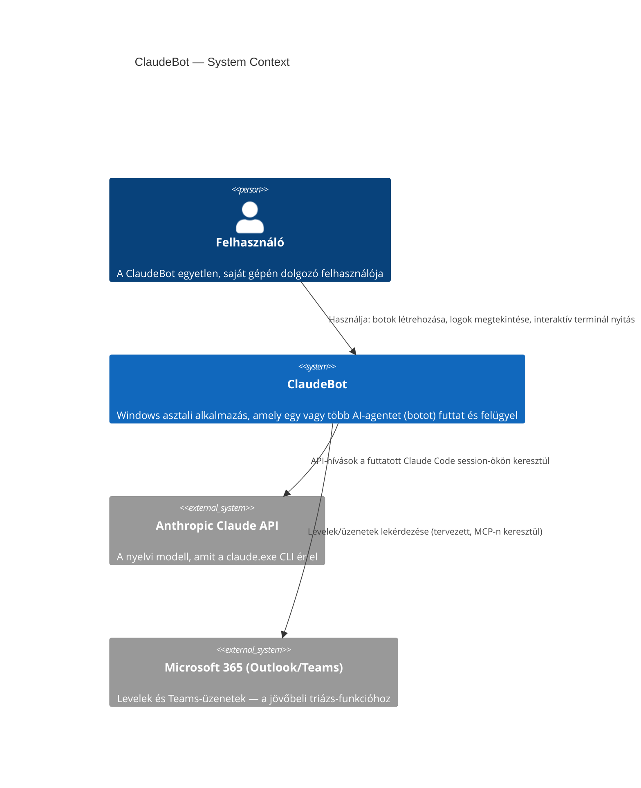

## Leírás

A rendszer egyetlen System-et tartalmaz a határon belül: a ClaudeBot Windows asztali alkalmazást.
Egy szereplő van (a felhasználó), és két külső rendszer: az Anthropic Claude API (amit a
`claude.exe` CLI ér el a háttérben), és a Microsoft 365 (Outlook/Teams), amit a jövőbeli
triázs-funkció (ld. UC-001, UC-002) fog elérni.

## Diagram

## Elemek

| Elem | Típus | Leírás |
|---|---|---|
| Felhasználó | Person | A ClaudeBot egyetlen, saját gépén dolgozó felhasználója. |
| ClaudeBot | System | A teljes Windows asztali alkalmazás, mint fekete doboz: bot-kezelés, subprocess-felügyelet, UI. |
| Anthropic Claude API | System_Ext | A nyelvi modell szolgáltatása, amit minden futó `claude.exe` session a háttérben elér. |
| Microsoft 365 (Outlook/Teams) | System_Ext | Levelezés/Teams, amit a tervezett önálló triázs-funkció (UC-001) fog elérni. |
