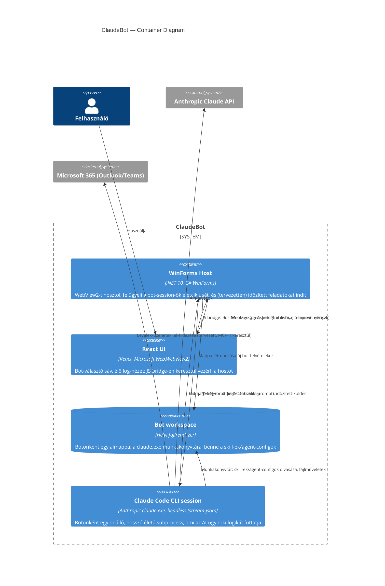

## Leírás

A ClaudeBot rendszeren belül négy container van: egy natív host alkalmazás (.NET WinForms), egy
abba ágyazott webes felhasználói felület (React, WebView2-n keresztül megjelenítve), egy helyi
fájlrendszer-alapú tároló botonként, és a ténylegesen futtatott AI-ügynöki folyamat (a `claude.exe`
CLI, headless módban). A natív host és a webes UI egy JavaScript-híd (bridge) üzeneteivel
kommunikál egymással; nincs külön szerver-container, a rendszer teljes egészében a felhasználó
gépén fut.

## Diagram

## Elemek

| Elem | Típus | Technológia | Leírás |
|---|---|---|---|
| WinForms Host | Container | .NET 10, C# WinForms | A natív alkalmazás-keret: egyetlen folyamat, ami a WebView2-t hosztolja, a bot-session-öket (subprocess-eket) indítja/leállítja, és a jövőben az időzített feladat-ütemezésért felel. |
| React UI | Container | React, Microsoft.Web.WebView2 | A teljes vizuális felület a WinForms Host-ba ágyazott WebView2 control-ban: bot-avatarok, élő log-nézet, (később) beállítások. |
| Bot workspace | Container (adattár) | Helyi fájlrendszer | Botonként egy almappa a program könyvtárán belül; ez a `claude.exe` munkakönyvtára, és ide kerülnek a skill-ek/agent-configok. |
| Claude Code CLI session | Container | Anthropic `claude.exe` (headless, `stream-json`) | Botonként egy önálló, hosszú életű subprocess; a tényleges AI-ügynöki feldolgozást végzi, és a Bot workspace mappájában fut. |
