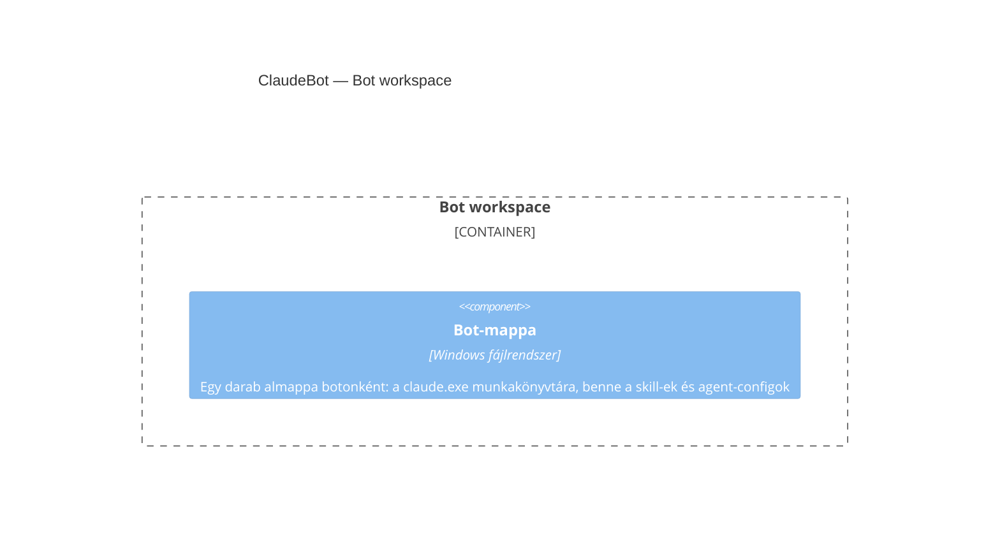

## Leírás

Ez a container nem bontható tovább komponensekre — egy sima, a Windows fájlrendszer által kezelt
mappa botonként, saját logika nélkül. Feketedobozként kezelendő.

## Diagram

## Elemek

| Elem | Típus | Leírás |
|---|---|---|
| Bot-mappa | Component | Az egyetlen elem ebben a container-ben; nincs belső komponens-struktúrája, a Windows fájlrendszer kezeli. |
