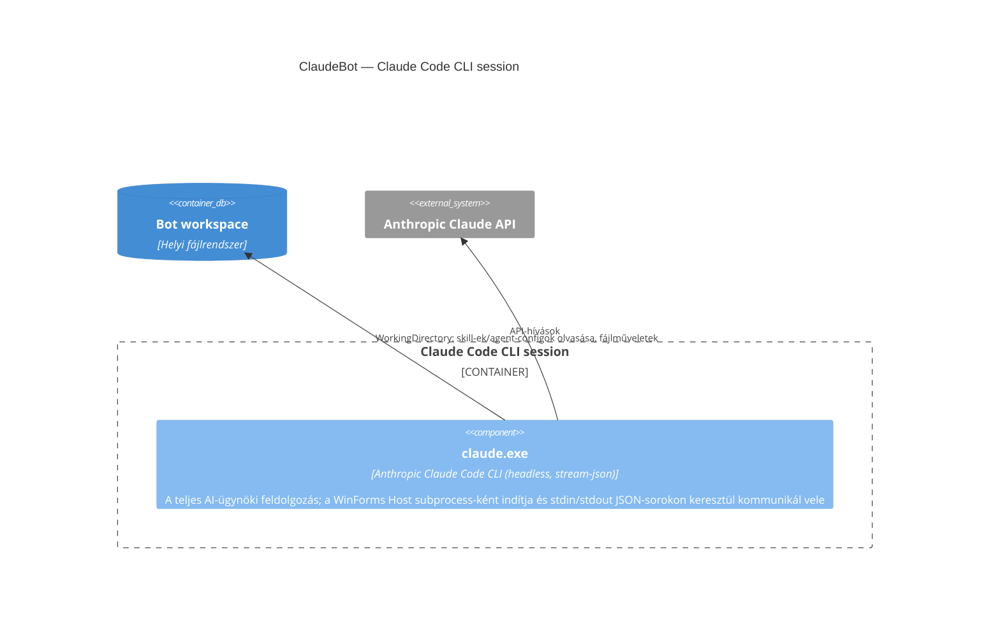

## Leírás

Ez a container nem bontható tovább komponensekre — a `claude.exe` egy külső, zárt futtatható
(Anthropic Claude Code CLI), aminek nincs saját forráskódunk vagy komponens-bontásunk róla.
Feketedobozként kezelendő a ClaudeBot architektúrája szempontjából.

## Diagram

## Elemek

| Elem | Típus | Leírás |
|---|---|---|
| claude.exe | Component | Az egyetlen elem ebben a container-ben; nincs belső komponens-struktúránk róla, mert ez egy külső, zárt futtatható. |
