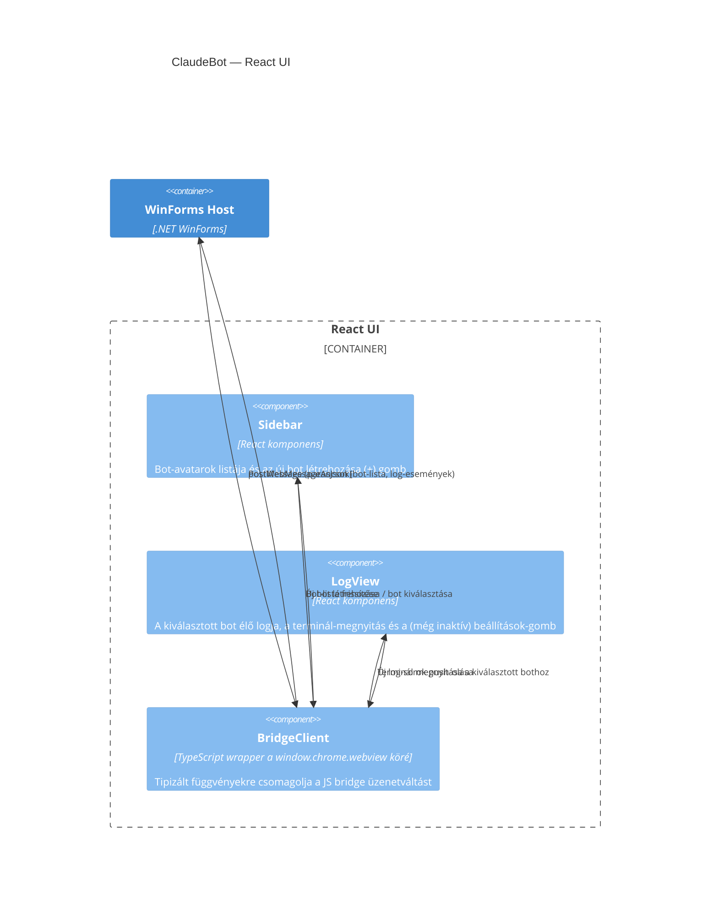

## Leírás

A React UI három belső komponensből áll: a bal oldali bot-választó sáv, a kiválasztott bot élő
logját és a hozzá tartozó műveleteket (terminál nyitása, beállítások-gomb) megjelenítő nézet, és a
WebView2 JS API-ját egyszerű függvényekre csomagoló híd-kliens. A beállítások nézet tartalma még
nincs kidolgozva — jelenleg csak egy funkció nélküli gomb jelzi a helyét.

## Diagram

## Elemek

| Elem | Típus | Leírás |
|---|---|---|
| Sidebar | Component | A bal oldali sáv: egy kör alakú avatar-gomb botonként, legalul a "+" gomb új bot létrehozásához. |
| LogView | Component | A kiválasztott bot élő log-területe, a terminál-megnyitás ("Open") és a jelenleg funkció nélküli beállítások-gomb. |
| BridgeClient | Component | A `window.chrome.webview.postMessage`/`addEventListener('message')` API-t tipizált, Promise-alapú függvényekre csomagoló kliensréteg; ezen keresztül éri el mind a Sidebar, mind a LogView a WinForms Host-ot. |
