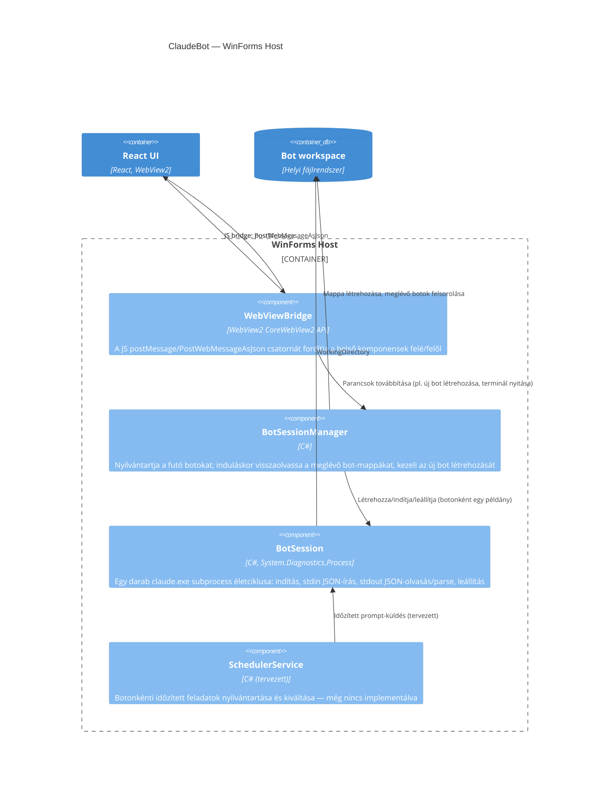

## Leírás

A WinForms Host négy belső komponensből áll: a bot-session-ök felügyeletéért felelős menedzser, a
futó `claude.exe` subprocess egy-egy példányát becsomagoló session-objektum, a (jelenleg még nem
implementált) időzített feladat-ütemező, és a WebView2 JavaScript-hídját kezelő réteg, ami a React
UI felé/felől fordítja az üzeneteket.

## Diagram

## Elemek

| Elem | Típus | Leírás |
|---|---|---|
| WebViewBridge | Component | A WebView2 `WebMessageReceived`/`PostWebMessageAsJson` csatornáját JSON-üzenetekre fordítja a React UI és a belső komponensek között. |
| BotSessionManager | Component | A bot-lista kezelése: induláskor a `Bots` mappa almappáiból visszaállítja a botokat, új bot létrehozásakor mappát hoz létre és elindítja a session-t. |
| BotSession | Component | A jelenlegi implementáció központi eleme: egy `claude.exe` subprocess indítása (`-p --input-format stream-json --output-format stream-json --verbose`), a stdin/stdout JSON-sorok kezelése, leállítás. |
| SchedulerService | Component | Tervezett komponens: botonkénti időzítés alapján prompt-okat küldene a megfelelő `BotSession`-nek — a jelenlegi körben még nincs kidolgozva. |
