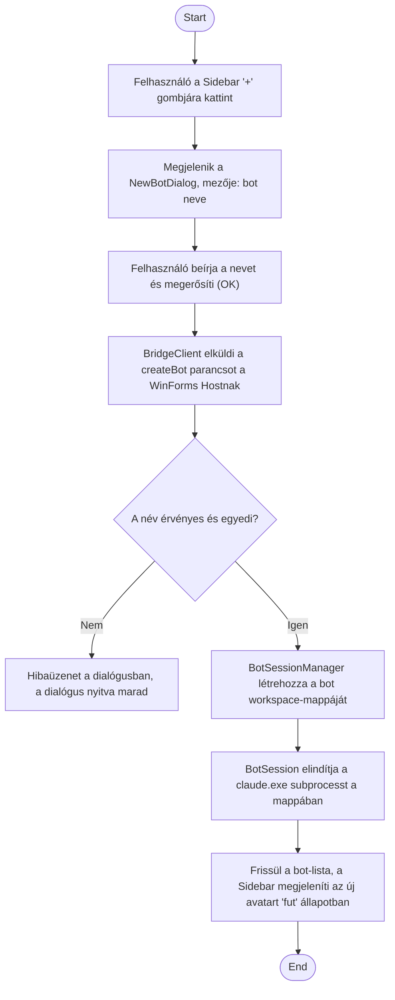

1. **Name:** Új bot (agent-session) létrehozása

2. **Goal / short description:** A felhasználó a Sidebar "+" gombjával új botot hoz létre, aminek
   saját workspace-mappája és saját, futó `claude.exe` agent-session-je lesz.
   - **2.1 Precondition:** A ClaudeBotApp fut (WinForms Host + React UI inicializálva).
   - **2.2 Exclusions:** Nem tartalmazza a `claude.exe` CLI telepítését, sem a bot workspace
     tartalmának (skillek, agent-configok) utólagos, kézi feltöltését.

3. **Actors:** Primary: felhasználó. Secondary: `BotSessionManager`, `BotSession` (a `claude.exe`
   subprocess felügyelője).

4. **Flow:**

5. **Potential errors:** A megadott név üres, érvénytelen fájlnév-karaktert tartalmaz, vagy már
   létező bot neve → inline hibaüzenet a dialógusban, nincs mappa- vagy session-létrehozás; a
   `claude.exe` indítása sikertelen → a bot létrejön, de "hiba" állapotba kerül, a hiba naplózódik.

6. **Expected outcome:** Az új bot megjelenik a Sidebar-ban, saját almappával a bot workspace-ek
   gyökerében, és egy élő `claude.exe` session áll mögötte, készen üzenet fogadására.
