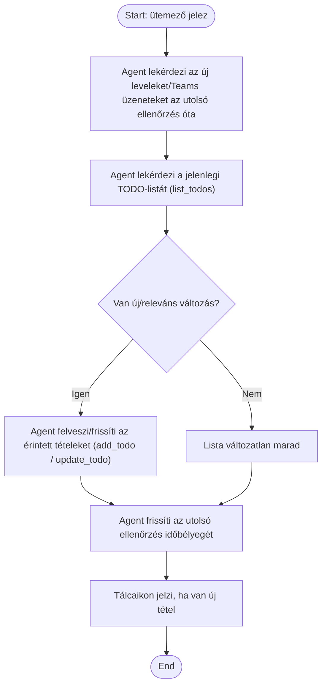

1. **Name:** Önálló triázs-futás és TODO-frissítés

2. **Goal / short description:** Az agent emberi beavatkozás nélkül, időzítve átnézi az új
   leveleket és Teams-üzeneteket, és ennek alapján karbantartja a felhasználó TODO-listáját.
   - **2.1 Precondition:** A ClaudeBot tálca-app fut, az agent workspace-e és a Microsoft 365
     MCP-kapcsolat be van állítva, és van egy rögzített "utoljára ellenőrizve" időbélyeg.
   - **2.2 Exclusions:** Nem küld el emailt vagy Teams-üzenetet — ez a futás kizárólag a
     TODO-listát módosíthatja.

3. **Actors:** Primary: ClaudeBot (ütemezett triázs-folyamat). Secondary: Outlook/Teams
   (Microsoft 365 MCP), TODO-store (`/mcp`).

4. **Flow:**

5. **Potential errors:** Microsoft 365 kapcsolódási hiba esetén a kör megszakad, az időbélyeg nem
   frissül, a hiba naplózódik, a következő ütemezett kör újra próbálkozik; ha nincs új üzenet, a
   lista változatlan marad, ez nem hibaállapot.

6. **Expected outcome:** A TODO-lista tükrözi az új leveleket/üzeneteket; a tálcaikon jelzi, ha van
   megtekintésre váró új tétel; a futás alatt semmilyen email/üzenet nem megy ki automatikusan.
