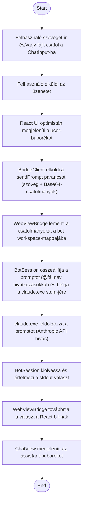

1. **Name:** Üzenet küldése az agentnek, csatolt fájllal

2. **Goal / short description:** A felhasználó szöveges üzenetet — opcionálisan egy vagy több,
   drag&drop-pal vagy vágólapról csatolt fájllal — küld a kiválasztott bot agentjének, és a
   választ a chat-felületen kapja vissza.
   - **2.1 Precondition:** Van kiválasztott, futó bot.
   - **2.2 Exclusions:** Nem részletezi a csatolmány-chip UI-interakcióját (ld. UI design
     szabályzat) — csak az üzenet- és fájl-adatfolyamot a kattintástól a válaszig.

3. **Actors:** Primary: felhasználó. Secondary: `BotSession`/`WebViewBridge`, `claude.exe`
   (Claude Code CLI session), bot workspace.

4. **Flow:**

5. **Potential errors:** Egy csatolmány mentése sikertelen → hibaüzenet a chatben, a többi
   csatolmány/üzenet feldolgozása folytatódik; a kiválasztott bot `claude.exe` folyamata nem fut
   → a prompt nem kerül elküldésre, hibaüzenet jelenik meg.

6. **Expected outcome:** A chat history tartalmazza a felhasználó üzenetét (csatolmány-jelzéssel
   együtt) és az agent válaszát; minden csatolt fájl ténylegesen bekerül a bot workspace
   mappájába, és a claude.exe ténylegesen hivatkozott rá a feldolgozás során.
