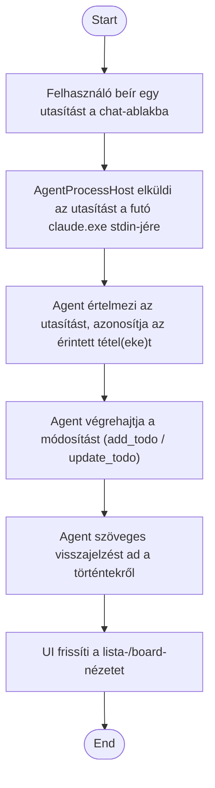

1. **Name:** TODO-lista korrigálása chaten keresztül

2. **Goal / short description:** A felhasználó ad-hoc utasítással módosítja a TODO-listát (tétel
   felvétele, törlése, lezárása) a chat-ablakon keresztül.
   - **2.1 Precondition:** A chat-ablak nyitva van egy futó (vagy indítható) agent-sessionhöz.
   - **2.2 Exclusions:** Nem vonatkozik levél vagy Teams-üzenet tényleges elküldésére — az agent
     itt kizárólag a TODO-store-t módosítja.

3. **Actors:** Primary: felhasználó. Secondary: TODO-store (`/mcp`).

4. **Flow:**

5. **Potential errors:** A hivatkozott tétel nem azonosítható egyértelműen → az agent visszakérdez,
   nem módosít semmit; a TODO-store átmenetileg nem elérhető → az agent jelzi a hibát, a
   chat-ablakban figyelmeztetés jelenik meg.

6. **Expected outcome:** A TODO-store a felhasználó szándéka szerint módosul, és ez azonnal
   látszik mind a chat-ablakban, mind a lista-/board-nézetben.
