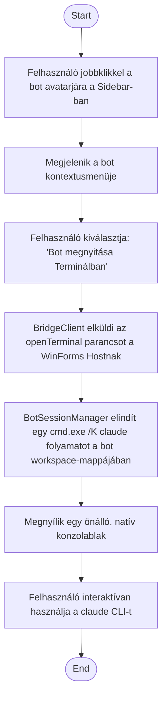

1. **Name:** Bot terminál-munkamenetének megnyitása

2. **Goal / short description:** A felhasználó egy natív konzolablakot nyit a kiválasztott bot
   workspace-mappájában, hogy közvetlenül, interaktívan használja a `claude` CLI-t, a chat-UI-tól
   függetlenül.
   - **2.1 Precondition:** Van kiválasztott bot.
   - **2.2 Exclusions:** Nem szünetelteti és nem helyettesíti a chat-UI mögött futó
     `BotSession`-t — a kettő egymástól független, párhuzamosan él.

3. **Actors:** Primary: felhasználó. Secondary: `BotSessionManager`, operációs rendszer
   (`cmd.exe`).

4. **Flow:**

5. **Potential errors:** A `cmd.exe`/`claude` folyamat indítása sikertelen (pl. a `claude` nem
   található a PATH-on) → hibaüzenet jelenik meg a chat-felületen, nem nyílik konzolablak.

6. **Expected outcome:** Egy önálló, natív terminálablak fut a bot workspace-mappájában, a
   chat-UI-n futó session-től függetlenül, azzal párhuzamosan.
