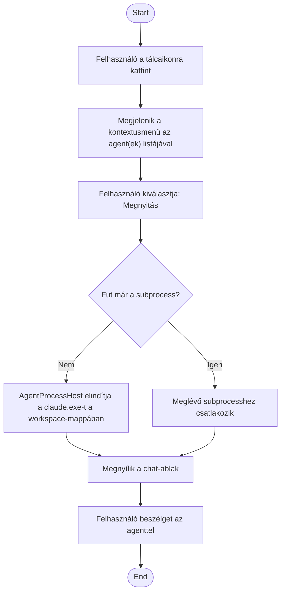

1. **Name:** Agent elérése a tálcáról

2. **Goal / short description:** A felhasználó a tálcaikonról megnyitja egy adott agent
   chat-ablakát, hogy beszélgessen vele vagy ellenőrizze az állapotát.
   - **2.1 Precondition:** A ClaudeBot tálca-app fut.
   - **2.2 Exclusions:** Nem tartalmazza a tálca-app első telepítését/konfigurálását.

3. **Actors:** Primary: felhasználó. Secondary: `AgentProcessHost` (a futtatott `claude.exe`
   subprocess).

4. **Flow:**

5. **Potential errors:** A subprocess indítása sikertelen (pl. a `claude.exe` nem található, vagy
   az MCP-végpont nem elérhető) → hibaüzenet jelenik meg a chat-ablakban, a tálcaikon hibát jelez.

6. **Expected outcome:** A felhasználónak van egy élő, interaktív csatornája a futó agenthez; ha a
   session még él, a korábbi kontextus megmarad.
