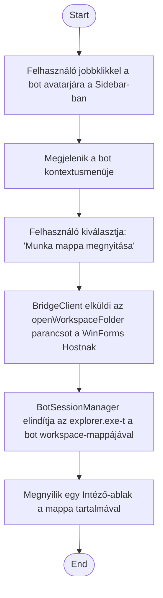

1. **Name:** Bot munkamappájának megnyitása Intézőben

2. **Goal / short description:** A felhasználó a kiválasztott bot workspace-mappáját natív
   Windows Intézőben (Explorer) nyitja meg, hogy közvetlenül hozzáférjen a bot fájljaihoz
   (skillek, agent-configok, a chaten keresztül csatolt fájlok).
   - **2.1 Precondition:** Van kiválasztott bot.
   - **2.2 Exclusions:** Nem helyettesíti a terminál-munkamenetet (ld. UC-003) — ez kizárólag
     fájlkezelő nézetet nyit, nem indít CLI-interakciót.

3. **Actors:** Primary: felhasználó. Secondary: `BotSessionManager`, operációs rendszer
   (`explorer.exe`).

4. **Flow:**

5. **Potential errors:** Az `explorer.exe` indítása sikertelen → hibaüzenet jelenik meg a
   chat-felületen, nem nyílik Intéző-ablak.

6. **Expected outcome:** Egy natív Intéző-ablak mutatja a bot workspace-mappájának tartalmát, a
   chat-UI-tól és a terminál-munkamenettől függetlenül.
