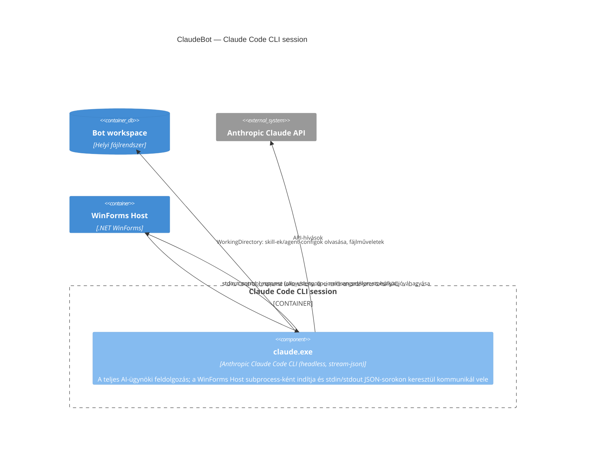

## Leírás

Ez a container nem bontható tovább komponensekre — a `claude.exe` egy külső, zárt futtatható
(Anthropic Claude Code CLI), aminek nincs saját forráskódunk vagy komponens-bontásunk róla.
Feketedobozként kezelendő a ClaudeBot architektúrája szempontjából.

A stdin/stdout interfész-szerződése egyirányúból **kétirányúvá** bővült (ADR-0004): a
`claude.exe` a stdout-ra immár nemcsak beszélgetés-eseményeket ír, hanem — a
`--permission-prompt-tool stdio` kapcsoló mellett — tool-jóváhagyási control-kéréseket is, és a
stdin-en ugyanilyen control-válaszokat vár vissza. Ez a csatorna nem a nyilvánosan dokumentált
felülete a CLI-nek; a sémáját a WinForms Host a telepített bináris elemzésével és éles méréssel
derítette fel.

## Diagram

## Elemek

| Elem | Típus | Leírás |
|---|---|---|
| claude.exe | Component | Az egyetlen elem ebben a container-ben; nincs belső komponens-struktúránk róla, mert ez egy külső, zárt futtatható. |
