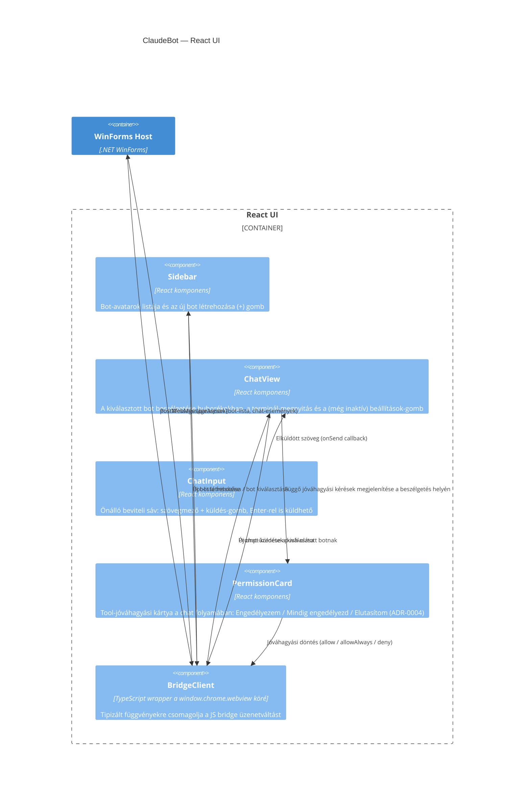

## Leírás

A React UI négy belső komponensből áll: a bal oldali bot-választó sáv, a kiválasztott bot
beszélgetését buborékokban megjelenítő chat-nézet, egy önálló, bővíthető beviteli komponens (a
chat-nézeten belül), és a WebView2 JS API-ját egyszerű függvényekre csomagoló híd-kliens. A
beállítások nézet tartalma még nincs kidolgozva — jelenleg csak egy funkció nélküli gomb jelzi a
helyét.

## Diagram

## Elemek

| Elem | Típus | Leírás |
|---|---|---|
| Sidebar | Component | A bal oldali sáv: egy kör alakú avatar-gomb botonként, legalul a "+" gomb új bot létrehozásához. |
| ChatView | Component | A kiválasztott bot beszélgetése: a user üzenetei jobbra, a bot válaszai balra igazított buborékokban; a terminál-megnyitás ("Open") és a jelenleg funkció nélküli beállítások-gomb a tetején; a ChatInput-ot ágyazza be alulra. |
| ChatInput | Component | Önálló komponens (nem a ChatView JSX-ébe írt beviteli mező), hogy a jövőbeli bővítések (pl. csatolmányok, parancsok) ne a ChatView-t érintsék. Szövegmező + küldés-gomb; `Enter` küld, `Shift+Enter` új sort kezd. |
| PermissionCard | Component | A bot egy nem engedélyezett eszközt kér — a kártya a beszélgetés időrendi helyén jelenik meg (nem modálisan), így nem blokkolja a felületet, és több bot függő kérése is megfér egymás mellett. Állapota (pending/allowed/denied/timedOut/cancelled) a válasz vagy a lejárat után is megmarad a chat-folyamban. |
| BridgeClient | Component | A `window.chrome.webview.postMessage`/`addEventListener('message')` API-t tipizált, Promise-alapú függvényekre csomagoló kliensréteg; ezen keresztül éri el mind a Sidebar, mind a ChatView a WinForms Host-ot. |
