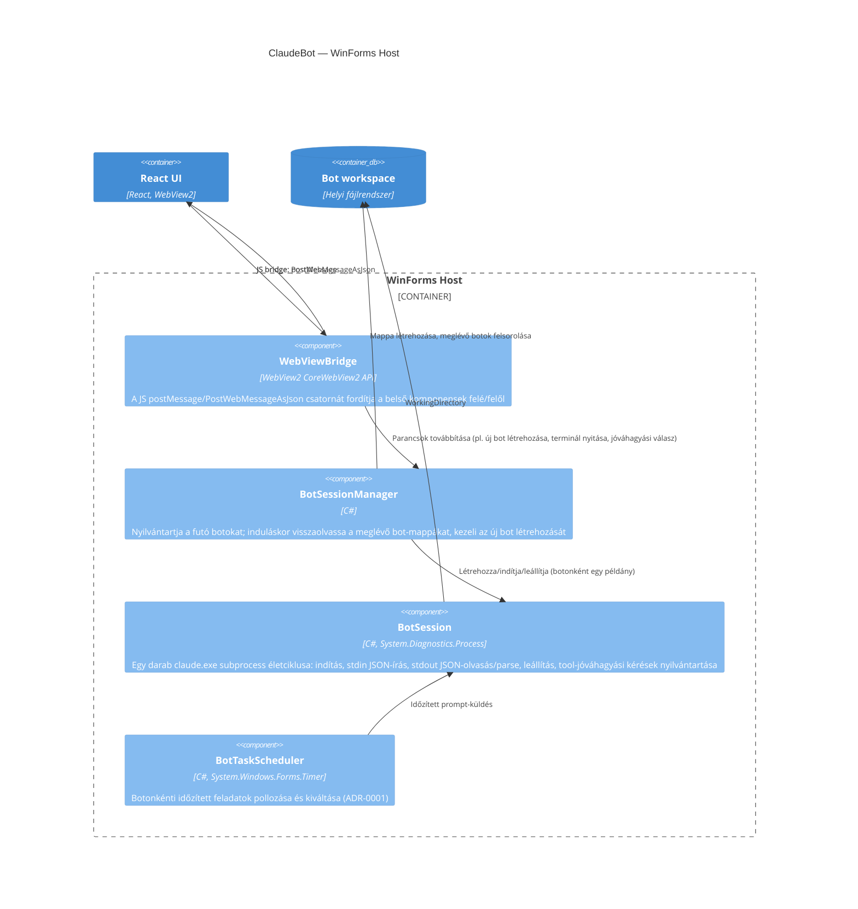

## Leírás

A WinForms Host négy belső komponensből áll: a bot-session-ök felügyeletéért felelős menedzser, a
futó `claude.exe` subprocess egy-egy példányát becsomagoló session-objektum, az időzített
feladatokat pollozó ütemező (ADR-0001), és a WebView2 JavaScript-hídját kezelő réteg, ami a React
UI felé/felől fordítja az üzeneteket.

A `BotSession` a tool-jóváhagyási kérések (ADR-0004) élettartamát is birtokolja: ezek a kérések
kizárólag az őt kiállító `claude.exe` példányon belül értelmesek, ezért a nyilvántartásuk ugyanott
él, ahol a folyamat maga — nem a menedzserben vagy a hídban, amik állapotmentesek maradnak.

## Diagram

## Elemek

| Elem | Típus | Leírás |
|---|---|---|
| WebViewBridge | Component | A WebView2 `WebMessageReceived`/`PostWebMessageAsJson` csatornáját JSON-üzenetekre fordítja a React UI és a belső komponensek között. |
| BotSessionManager | Component | A bot-lista kezelése: induláskor a `Bots` mappa almappáiból visszaállítja a botokat, új bot létrehozásakor mappát hoz létre és elindítja a session-t. |
| BotSession | Component | A jelenlegi implementáció központi eleme: egy `claude.exe` subprocess indítása (`-p --input-format stream-json --output-format stream-json --verbose`), a stdin/stdout JSON-sorok kezelése, leállítás. A tool-jóváhagyási kérések (ADR-0004) élettartamát is ez birtokolja: a kérés válaszáig vagy a folyamat leállásáig tartja nyilván, és egyetlen zárolt metóduson keresztül ír a stdin-re, hogy a több szálról (UI-szál, lejárati időzítő, kimenet-olvasó szál) érkező válaszok ne keveredjenek össze. |
| BotTaskScheduler | Component | 30 másodpercenként pollozva indítja az esedékes feladatokat (ADR-0001); egy jóváhagyásra váró, válasz nélkül maradt kör esetén a futást sikertelenként zárja le, nem hagyja korlátlanul "folyamatban" állapotban. |
