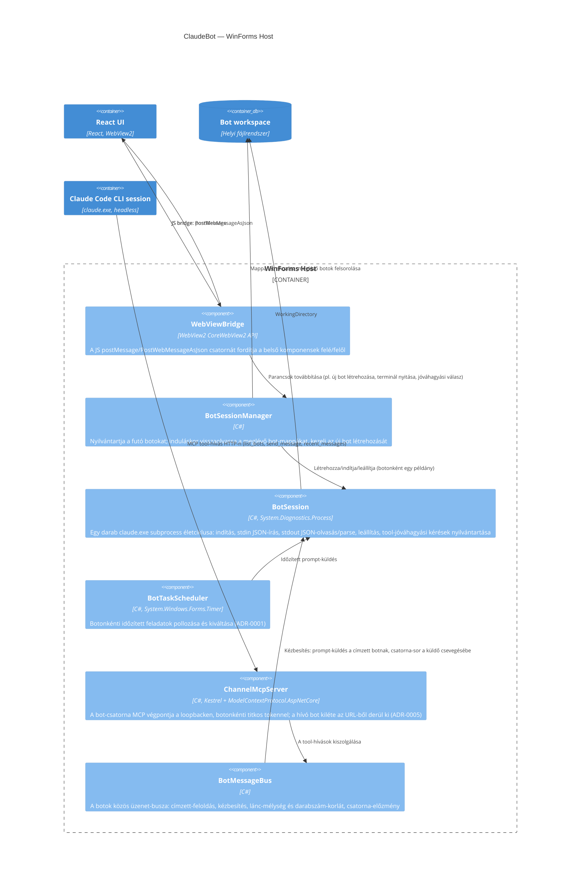

## Leírás

A WinForms Host hat belső komponensből áll: a bot-session-ök felügyeletéért felelős menedzser, a
futó `claude.exe` subprocess egy-egy példányát becsomagoló session-objektum, az időzített
feladatokat pollozó ütemező (ADR-0001), a WebView2 JavaScript-hídját kezelő réteg, ami a React
UI felé/felől fordítja az üzeneteket, valamint a botok közti üzenetváltást megvalósító busz és az
azt a botok felé kiajánló MCP szerver (ADR-0005).

A `BotSession` a tool-jóváhagyási kérések (ADR-0004) élettartamát is birtokolja: ezek a kérések
kizárólag az őt kiállító `claude.exe` példányon belül értelmesek, ezért a nyilvántartásuk ugyanott
él, ahol a folyamat maga — nem a menedzserben vagy a hídban, amik állapotmentesek maradnak.

A bot-csatorna két komponensre bomlik, mert két különböző dolgot csinálnak: a `ChannelMcpServer` a
*transzport* (HTTP-végpont a loopbacken, és a hívó bot azonosítása az URL tokenjéből), a
`BotMessageBus` pedig a *szabályok* helye (kézbesítés, címzett-feloldás, lánc-mélység és
darabszám-korlát). A kettő indítási sorrendje kötött: a szervernek a botok indulása előtt kell
élnie — a `claude.exe` a végpont címét csak induláskor kapja meg —, a busz viszont csak a menedzser
létrejötte után képződhet, ezért utólag kerül a szerverbe.

## Diagram

## Elemek

| Elem | Típus | Leírás |
|---|---|---|
| WebViewBridge | Component | A WebView2 `WebMessageReceived`/`PostWebMessageAsJson` csatornáját JSON-üzenetekre fordítja a React UI és a belső komponensek között. |
| BotSessionManager | Component | A bot-lista kezelése: induláskor a `Bots` mappa almappáiból visszaállítja a botokat, új bot létrehozásakor mappát hoz létre és elindítja a session-t. |
| BotSession | Component | A jelenlegi implementáció központi eleme: egy `claude.exe` subprocess indítása (`-p --input-format stream-json --output-format stream-json --verbose`), a stdin/stdout JSON-sorok kezelése, leállítás. A tool-jóváhagyási kérések (ADR-0004) élettartamát is ez birtokolja: a kérés válaszáig vagy a folyamat leállásáig tartja nyilván, és egyetlen zárolt metóduson keresztül ír a stdin-re, hogy a több szálról (UI-szál, lejárati időzítő, kimenet-olvasó szál) érkező válaszok ne keveredjenek össze. |
| BotTaskScheduler | Component | 30 másodpercenként pollozva indítja az esedékes feladatokat (ADR-0001); egy jóváhagyásra váró, válasz nélkül maradt kör esetén a futást sikertelenként zárja le, nem hagyja korlátlanul "folyamatban" állapotban. |
| ChannelMcpServer | Component | A bot-csatorna transzportja (ADR-0005): in-process Kestrel, kizárólag a loopbacken, dinamikus porton. Botonként külön, titkos tokenű végpontot szolgál ki — ebből azonosítja a hívót, ismeretlen tokenre 404-gyel válaszol. A botok három eszközt látnak rajta: `list_bots`, `send_message`, `recent_messages`. |
| BotMessageBus | Component | A csatorna szabályai egy helyen: feloldja a címzetteket (ismeretlen, önmaga, nem futó vagy a csatornáról kikapcsolt bot kimarad, indoklással), kézbesít a címzettek session-jének, vezeti a válasz-láncok mélységét és a botonkénti darabszám-korlátot, és megtartja az utolsó üzeneteket utólagos felzárkózáshoz. A kézbesítés szándékosan a belső zároláson kívül fut, mert UI-szálra marshalolódó eseményeket vált ki. |
