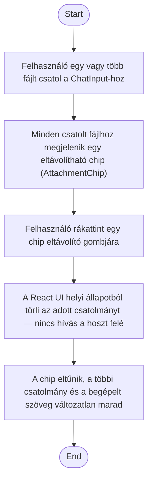

1. **Name:** Csatolt fájl eltávolítása küldés előtt

2. **Goal / short description:** A felhasználó egy már a chat-bevitelbe húzott/beillesztett, de
   még el nem küldött fájlt meggondol, és eltávolítja azt, mielőtt elküldené az üzenetet.
   - **2.1 Precondition:** A felhasználó legalább egy fájlt csatolt (drag&drop vagy vágólap) a
     ChatInput-hoz, az üzenet még nincs elküldve.
   - **2.2 Exclusions:** Nem tárgyalja a fájl csatolásának módját (drag&drop, vágólap) és az
     üzenet tényleges elküldését — ezeket a UC-002 fedi le.

3. **Actors:** Primary: felhasználó. Secondary: –

4. **Flow:**

5. **Potential errors:** –

6. **Expected outcome:** Az eltávolított fájl nem kerül elküldésre az üzenettel együtt; a
   felhasználó a megmaradt csatolmányokkal (vagy csatolmány nélkül) küldheti el az üzenetet.
