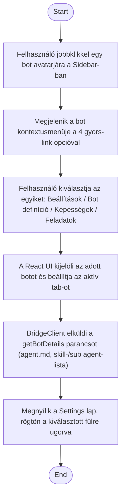

1. **Name:** Bot beállításainak gyors elérése a jobbklikk menüből

2. **Goal / short description:** A felhasználó a Sidebar-ban egy bot avatarjára jobbklikkelve
   közvetlenül a Settings lap kívánt fülére (Beállítások / Bot definíció / Képességek /
   Feladatok) navigál, anélkül hogy előbb meg kellene nyitnia a lapot és kézzel kiválasztania a
   fület.
   - **2.1 Precondition:** Van legalább egy bot a Sidebar-ban.
   - **2.2 Exclusions:** Nem tárgyalja a Settings lap egyes füleinek tartalmát és az ottani
     szerkesztést — ezeket a UC-008, UC-009 és UC-010 fedi le.

3. **Actors:** Primary: felhasználó. Secondary: `WebViewBridge`, `BotSessionManager`.

4. **Flow:**

5. **Potential errors:** –

6. **Expected outcome:** A Settings lap nyitva van, az aktív fül pontosan az, amit a felhasználó
   a kontextusmenüből kiválasztott.
