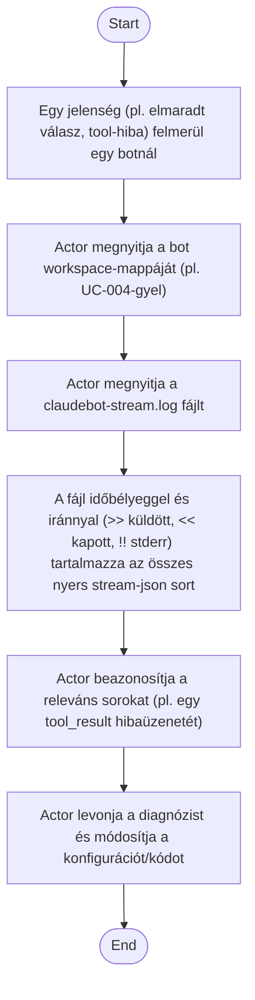

1. **Name:** Bot nyers kommunikációjának visszakeresése hibakereséshez (debug napló)

2. **Goal / short description:** Egy fejlesztő — vagy egy fejlesztést segítő AI agent, aki ebben
   a flow-ban egyenrangú actor lehet egy emberi felhasználóval — visszakeresi, pontosan mit
   küldött/kapott a `claude.exe` egy adott bot session során, hogy diagnosztizáljon egy olyan
   jelenséget, amit a chat-UI nem jelenít meg strukturáltan (pl. egy néma tool-engedély
   elutasítást).
   - **2.1 Precondition:** A bot legalább egyszer elindult és kapott/küldött legalább egy
     stream-json sort.
   - **2.2 Exclusions:** Nem tárgyalja a napló tartalmának UI-beli megjelenítését — a naplót a
     felhasználó/agent közvetlenül a fájlrendszeren olvassa, a ClaudeBotApp nem jeleníti meg.

3. **Actors:** Primary: fejlesztő vagy diagnosztizáló AI agent. Secondary: `BotSession` (a napló
   írója), fájlrendszer.

4. **Flow:**

5. **Potential errors:** A napló fájl még nem létezik, ha a bot még sosem kapott promptot →
   nincs mit visszakeresni.

6. **Expected outcome:** Az actor pontosan látja, milyen sorrendben, milyen tartalommal zajlott a
   `claude.exe` és a host közti kommunikáció, és ez alapján azonosítja a hiba okát.
