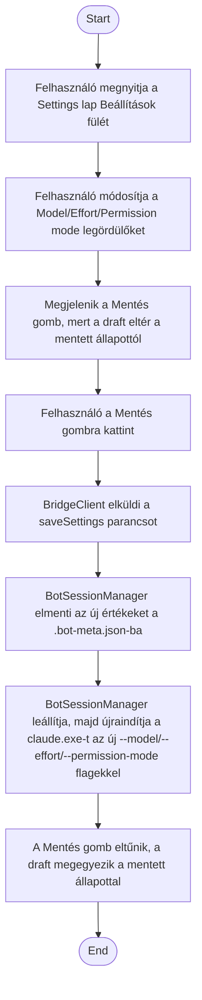

1. **Name:** Bot futási beállításainak (model/effort/permission mode) módosítása

2. **Goal / short description:** A felhasználó a Settings lap "Beállítások" fülén módosítja,
   melyik modellt, milyen effort-szinttel és milyen engedélyezési móddal futtassa a bot
   `claude.exe` session-je, majd a mentéskor a bot automatikusan újraindul az új beállításokkal.
   - **2.1 Precondition:** Van kiválasztott bot, a Settings lap "Beállítások" fülén áll.
   - **2.2 Exclusions:** Nem tárgyalja a tool-engedélyek (UC-009) és az ütemezett feladatok
     (UC-010) szerkesztését, bár technikailag ugyanaz a Mentés gomb viszi át mindhármat.

3. **Actors:** Primary: felhasználó. Secondary: `BotSessionManager` (`ApplySettings`),
   `BotSession` (újraindítás), `claude.exe`.

4. **Flow:**

5. **Potential errors:** A mentés közben a bot neve ütközik egy másik bottal (csak akkor
   releváns, ha a névmező is módosult) → hibaüzenet a Settings lapon, a módosítások nem vesznek
   el, újra menthető.

6. **Expected outcome:** A bot ezentúl a kiválasztott modellel, effort-szinttel és permission
   móddal fut; a beállítás a `.bot-meta.json`-ban perzisztálva marad az app újraindítása után is.
