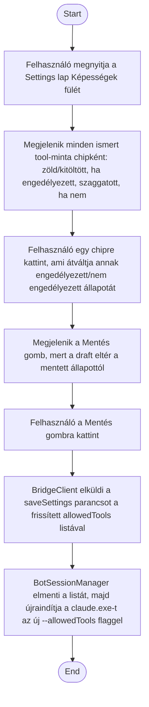

1. **Name:** Bot engedélyezett tool-jainak szabályozása

2. **Goal / short description:** A felhasználó a Settings lap "Képességek" fülén be- vagy
   kikapcsolja, mely MCP-szerverek tool-jait használhatja automatikusan a bot headless módban —
   mivel a `claude.exe` headless futásnál nincs felugró jóváhagyás, enélkül minden nem explicit
   engedélyezett tool-hívás némán elutasításra kerülne.
   - **2.1 Precondition:** Van kiválasztott bot, a Settings lap "Képességek" fülén áll.
   - **2.2 Exclusions:** Nem ad lehetőséget natív tool-ok (pl. Bash) engedélyezésére, és nem
     tartalmazza a sub agent-ek/skill-ek karbantartását — azok ezen a fülön csak információs
     listaként jelennek meg, szerkesztés nélkül.

3. **Actors:** Primary: felhasználó. Secondary: `BotSessionManager` (`ApplySettings`),
   `claude.exe` (`--allowedTools`).

4. **Flow:**

5. **Potential errors:** –

6. **Expected outcome:** A bot a mentés után csak az engedélyezett minták alá eső tool-okat
   érheti el automatikusan; minden más tool-hívás továbbra is elutasításra kerül.
