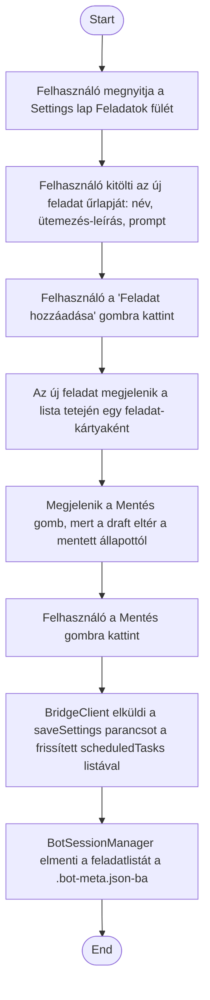

1. **Name:** Ütemezett feladat definiálása egy bot számára

2. **Goal / short description:** A felhasználó a Settings lap "Feladatok" fülén rögzít egy
   ütemezett feladatot (név, ütemezés-leírás, az agentnek szánt prompt) egy adott bothoz, hogy
   később — amint a tényleges időzítő motor elkészül — a bot magától, emberi beavatkozás nélkül
   végrehajthassa azt.
   - **2.1 Precondition:** Van kiválasztott bot, a Settings lap "Feladatok" fülén áll.
   - **2.2 Exclusions:** **Nem tartalmazza a feladat tényleges, ütemezés szerinti
     végrehajtását** — ez a use case kizárólag a feladat-definíció rögzítéséig tart, a
     scheduler-motor még nincs megvalósítva.

3. **Actors:** Primary: felhasználó. Secondary: `BotSessionManager` (`ApplySettings`).

4. **Flow:**

5. **Potential errors:** Üres névvel nem adható hozzá feladat → a 'Feladat hozzáadása' gomb
   hatástalan marad, amíg a felhasználó nem ad meg nevet.

6. **Expected outcome:** A feladat-definíció tartósan elmentve szerepel a bot
   `.bot-meta.json`-jában, és megjelenik a Feladatok fülön legközelebbi megnyitáskor is — de
   **önmagától nem fut le**, amíg a scheduler-motor meg nem valósul.
