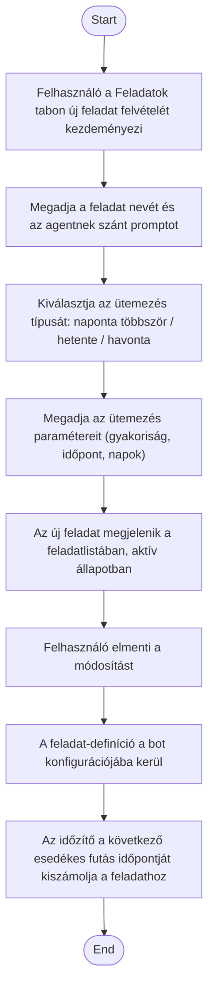

1. **Name:** Ütemezett feladat definiálása egy bot számára

2. **Goal / short description:** A felhasználó a fő képernyő "Feladatok" tabján rögzít egy
   visszatérő feladatot (név, ütemezés, az agentnek szánt prompt) a kiválasztott bothoz, hogy a
   bot azt a megadott időzítés szerint, emberi beavatkozás nélkül, ismételten elvégezze.
   - **2.1 Precondition:** Van kiválasztott bot, a felhasználó a "Feladatok" tabon áll.
   - **2.2 Exclusions:** Nem tartalmazza a feladat tényleges lefutását (UC-013), kézi
     futtatását (UC-014), módosítását (UC-011) és szüneteltetését (UC-012).

3. **Actors:** Primary: felhasználó. Secondary: a bot-konfiguráció perzisztenciája.

4. **Flow:**

5. **Potential errors:** Üres név vagy üres prompt → a feladat nem vehető fel, a felhasználó
   jelzést kap; hiányosan megadott ütemezés (heti vagy havi típusnál egyetlen nap sincs
   kijelölve) → a feladat nem vehető fel, amíg az ütemezés nem teljes. Napi ismétlődés a heti
   típusnál mind a hét nap kijelölésével adható meg ("minden nap" kapcsoló). Havi ütemezésnél a 29–31.
   napok olyan hónapokban is kijelölhetők, amelyekben nem létezik ilyen nap — ilyenkor a futás a
   hónap utolsó napjára csúszik, hogy egyetlen hónap se maradjon ki; a felületen erről a
   felhasználó magyarázatot kap.

6. **Expected outcome:** A feladat tartósan elmentve szerepel a bot konfigurációjában, aktív
   állapotban, kiszámolt következő futási időponttal — és az alkalmazás futása alatt az időzítő
   szerint magától le fog futni (UC-013).
