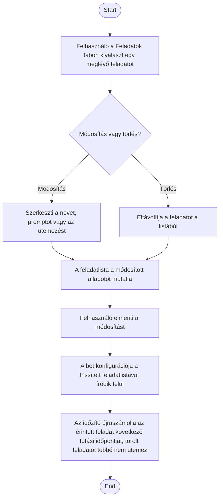

1. **Name:** Ütemezett feladat módosítása vagy törlése

2. **Goal / short description:** A felhasználó egy már létező feladat nevét, promptját vagy
   ütemezését megváltoztatja — vagy a feladatot véglegesen eltávolítja —, mert a feladat célja
   vagy a kívánt gyakoriság megváltozott.
   - **2.1 Precondition:** A kiválasztott bothoz van legalább egy rögzített feladat.
   - **2.2 Exclusions:** Nem fedi le a feladat ideiglenes felfüggesztését (arra a szüneteltetés
     való, UC-012) és a már lefutott futások előzményeinek törlését.

3. **Actors:** Primary: felhasználó. Secondary: a bot-konfiguráció perzisztenciája, időzítő.

4. **Flow:**

5. **Potential errors:** A módosítás a feladatot érvénytelen állapotba vinné (üres név/prompt,
   hiányos ütemezés) → a mentés nem engedélyezett, amíg a felhasználó nem javítja; mentés nélküli
   elnavigálás esetén a felhasználó megerősítést kap, hogy a módosítások elvesznek.

6. **Expected outcome:** A bot konfigurációja a feladat új tartalmát tükrözi (vagy a feladat
   nem szerepel benne többé), és a következő automatikus futás már az új ütemezés szerint
   történik; egy törölt feladat soha többé nem fut le.
