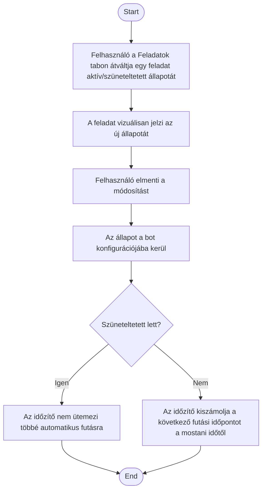

1. **Name:** Ütemezett feladat szüneteltetése és újraaktiválása

2. **Goal / short description:** A felhasználó ideiglenesen felfüggeszti egy feladat automatikus
   futását — anélkül, hogy a definícióját elveszítené —, majd később újra aktiválja. Jellemző
   okok: szabadság, egy külső rendszer karbantartása, vagy egy feladat átmeneti zajossága.
   - **2.1 Precondition:** A kiválasztott bothoz van legalább egy rögzített feladat.
   - **2.2 Exclusions:** Nem akadályozza meg a feladat kézi, azonnali futtatását (UC-014) — egy
     szüneteltetett feladat kézzel továbbra is elindítható.

3. **Actors:** Primary: felhasználó. Secondary: időzítő, bot-konfiguráció perzisztenciája.

4. **Flow:**

5. **Potential errors:** Ha a feladat épp fut, amikor a felhasználó szüneteltetésre váltja, a
   folyamatban lévő futás nem szakad meg — a szüneteltetés csak a további automatikus futásokra
   vonatkozik.

6. **Expected outcome:** Egy szüneteltetett feladat az alkalmazás újraindítása után is
   szüneteltetett marad, és addig nem fut le magától, amíg a felhasználó újra nem aktiválja;
   újraaktiváláskor a következő futás a jelenlegi időponttól számítva esedékes, a szünet alatt
   kimaradt futásokat nem pótolja.
