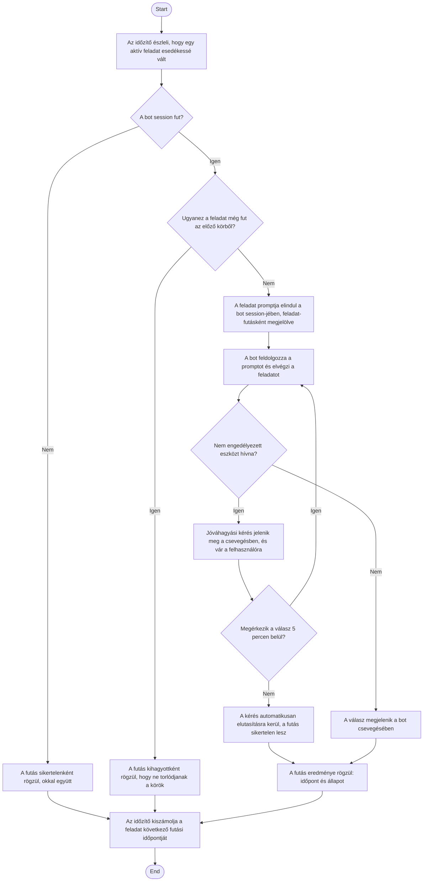

1. **Name:** Ütemezett feladat automatikus lefutása

2. **Goal / short description:** Egy aktív feladat esedékessé válik, és a bot emberi beavatkozás
   nélkül elvégzi azt — ez az alkalmazás fő funkciója: a botok visszatérően, maguktól dolgoznak.
   A felhasználó a csevegésben látja, mit csinált a bot, és a feladat futási állapota is
   frissül.
   - **2.1 Precondition:** A feladat aktív (nincs szüneteltetve), az alkalmazás fut, és elérkezett
     a feladat következő futási időpontja. Az alkalmazás ablaka lehet elrejtve a tálcára — a
     feladatok attól még futnak; a futáshoz csak az kell, hogy a folyamat éljen.
   - **2.2 Exclusions:** Nem pótolja az alkalmazás leállított állapota alatt kimaradt futásokat
     azon túl, amit a pótlási szabály megenged — a feladatok kizárólag futó alkalmazás mellett
     indulnak el. Nem fedi le a kézi futtatást (UC-014).

3. **Actors:** Primary: időzítő (idővezérelt indítás, a felhasználó javára). Secondary: a bot
   `claude.exe` session-je, a csevegés-nézet.

4. **Flow:**

5. **Potential errors:** A bot nem fut (leállt vagy hibás állapotú) → a futás sikertelenként
   rögzül, a rendszer nem indítja újra magától a botot; az előző futás még tart → az új kör
   kihagyásra kerül; a bot hibát jelez a feldolgozás során → a futás sikertelenként rögzül, a
   hibaüzenet a csevegésben látható; a futás jóváhagyásra várt, de nem érkezett válasz a
   határidőig → a futás sikertelenként rögzül, a hibaszövegben a kért eszköz nevével. Ha a bot
   a kör közben leáll vagy újraindul, a futás nem marad örökre "folyamatban": sikertelenként
   lezárul, így a feladat a következő esedékességkor újra indulhat.

6. **Expected outcome:** A feladat ténylegesen elvégződött a bot által, eredménye a csevegésben
   visszakereshető, a feladat futási állapota (utolsó futás időpontja és kimenetele) frissült, és
   a következő futás be van ütemezve.
