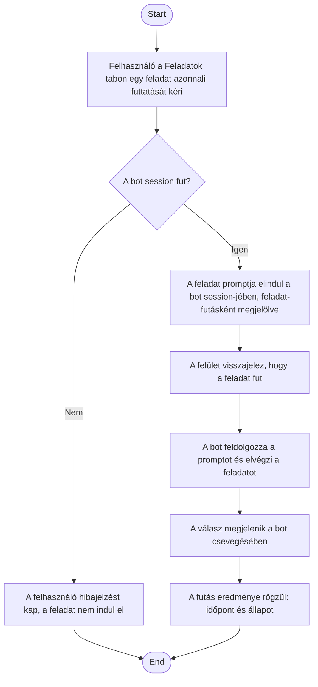

1. **Name:** Ütemezett feladat azonnali, kézi futtatása

2. **Goal / short description:** A felhasználó azonnal lefuttat egy feladatot, anélkül hogy
   megvárná a következő esedékes időpontot — jellemzően hogy kipróbálja, jól van-e megfogalmazva
   a prompt, vagy mert soron kívül szüksége van az eredményre.
   - **2.1 Precondition:** A kiválasztott bothoz van legalább egy rögzített feladat.
   - **2.2 Exclusions:** Nem módosítja a feladat ütemezését — a következő automatikus futás
     időpontja a kézi futtatástól függetlenül, változatlanul marad.

3. **Actors:** Primary: felhasználó. Secondary: a bot `claude.exe` session-je, a csevegés-nézet.

4. **Flow:**

5. **Potential errors:** A bot nem fut → a felhasználó azonnali hibajelzést kap, és nem indul
   futás; a feladat épp fut (automatikus vagy korábbi kézi indításból) → a felhasználó jelzést
   kap, és nem indul párhuzamos második futás.

6. **Expected outcome:** A feladat azonnal lefutott, az eredmény a csevegésben látható, a futási
   állapota frissült — miközben a feladat automatikus ütemezése érintetlen maradt. Egy
   szüneteltetett feladat is futtatható ezen az úton.
