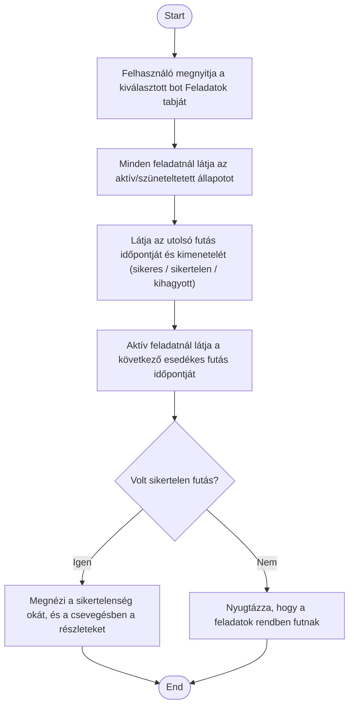

1. **Name:** Feladat-futások állapotának áttekintése

2. **Goal / short description:** A felhasználó megnézi, hogy a bot feladatai ténylegesen
   lefutottak-e: mikor futott utoljára egy feladat, sikeres volt-e, és mikor esedékes a
   következő futás. Enélkül egy magától dolgozó bot működése átláthatatlan lenne.
   - **2.1 Precondition:** A kiválasztott bothoz van legalább egy rögzített feladat.
   - **2.2 Exclusions:** Nem tartalmazza a feladat válaszának részletes megjelenítését — a
     feladat tényleges kimenete a bot csevegésében olvasható; itt csak a futás ténye és
     kimenetele látszik.

3. **Actors:** Primary: felhasználó. Secondary: –

4. **Flow:**

5. **Potential errors:** Egy feladat még sosem futott le → futási időpont helyett ezt jelző
   szöveg látszik, nem üres mező.

6. **Expected outcome:** A felhasználó egy pillantással látja, hogy a bot feladatai élnek-e,
   mikor dolgoztak utoljára, és mi várható — így észreveszi, ha egy feladat némán elhasalt.
