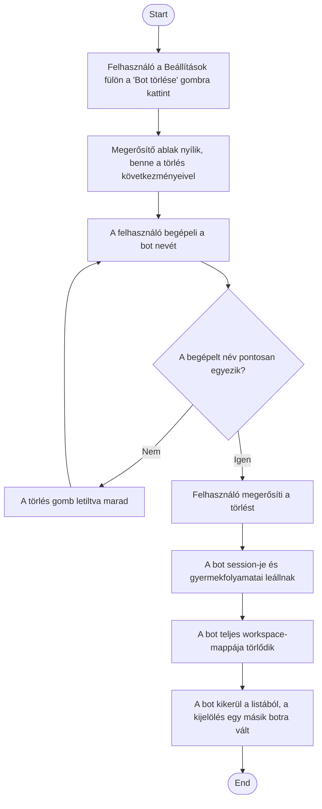

1. **Name:** Bot végleges törlése

2. **Goal / short description:** A felhasználó véglegesen megszabadul egy bottól: a bot
   beállításai, ütemezett feladatai, agent-definíciója és minden fájlja megszűnik, a
   workspace-mappájával együtt. Jellemző ok: a bot szerepe megszűnt, vagy kísérletezés közben
   keletkezett.
   - **2.1 Precondition:** Van kiválasztott bot, és a felhasználó a Settings lap "Beállítások"
     fülén áll.
   - **2.2 Exclusions:** Nem fedi le a bot ideiglenes leállítását — erre nincs külön művelet, a
     feladatok szüneteltetése (UC-012) a megfelelő eszköz, ha a bot meg akar maradni.

3. **Actors:** Primary: felhasználó. Secondary: `BotSessionManager`, a bot `claude.exe`
   session-je és annak gyermekfolyamatai, fájlrendszer.

4. **Flow:**

5. **Potential errors:** A mappa törlése sikertelen, mert valami kívülről fogja (pl. egy hozzá
   nyitott terminál) → a felhasználó hibaüzenetet kap, ami megmondja a teendőt: zárja be
   a mappát használó programot, törölje kézzel a mappát, és indítsa újra az alkalmazást. A bot a
   listában marad. **A törlés ekkor részlegesen végbemehetett**: a mappa tartalma eltűnhetett,
   miközben maga a (már üres) mappa — amit valami még fogva tart — megmarad; emiatt a kézi
   törlés és az újraindítás a javasolt, nem a helyben való újrapróbálkozás.

6. **Expected outcome:** A bot nem szerepel többé a listában, a workspace-mappája nem létezik, a
   hozzá tartozó ütemezett feladatok soha többé nem futnak le. A művelet nem vonható vissza.
