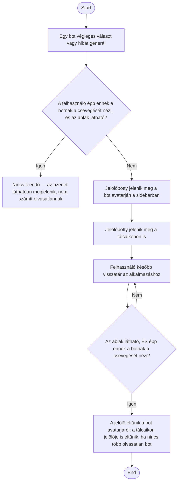

1. **Name:** Olvasatlan bot-üzenet jelzése

2. **Goal / short description:** A felhasználó egy pillantással látja, melyik botnak van olyan
   válasza vagy hibája, amit még nem nézett meg — akkor is, ha az alkalmazás ablaka épp a
   tálcára van rejtve (ADR-0003), vagy egy másik bot csevegését nézi. Így nem kell minden botot
   sorban megnyitnia, hogy kiderüljön, szólt-e hozzá valamelyik.
   - **2.1 Precondition:** Legalább egy bot fut, és képes választ vagy hibát generálni — tipikusan
     egy ütemezett feladat (UC-013) lefutása közben, amíg a felhasználó mással foglalkozik.
   - **2.2 Exclusions:** Nem számlálja az olvasatlan üzenetek darabszámát, kizárólag a tényt
     jelzi. Nem fedi le magának az üzenetnek a megjelenítését — az a csevegés-nézeté.

3. **Actors:** Primary: a bot (az eseményt kiváltó fél). Secondary: felhasználó (az eseményt
   később észlelő fél), a WinForms host (ablak-láthatóság és tálcaikon), React UI (sidebar).

4. **Flow:**

5. **Potential errors:** Az olvasatlansági állapot kizárólag memóriában él, nem kerül lemezre —
   az alkalmazás újraindítása után minden jelölő eltűnik, függetlenül attól, hogy a felhasználó
   ténylegesen megnézte-e a korábbi üzeneteket.

6. **Expected outcome:** A felhasználó a sidebar és a tálcaikon megnézésével eldöntheti, van-e
   olyan bot, amelyik szólt hozzá, anélkül hogy minden botot sorban meg kellene nyitnia. A jelzés
   nem számol, csak jelez — a pontos lefutás-történetet a Feladatok tab (UC-015) vagy maga a
   csevegés adja.
