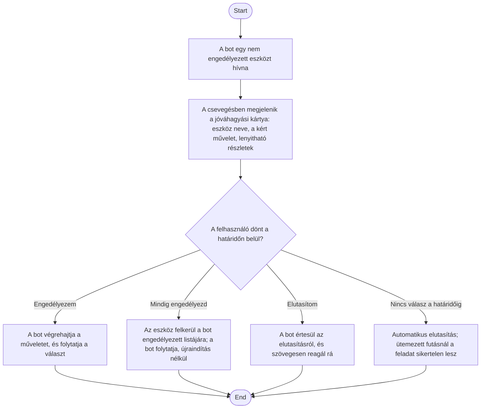

1. **Name:** Bot eszközhasználatának interaktív jóváhagyása

2. **Goal / short description:** A felhasználó futásidőben, esetenként dönt arról, hogy a bot
   használhat-e egy olyan eszközt, amire nincs előzetes engedélye — ahelyett, hogy az ilyen
   hívás némán elutasításra kerülne, és a bot egy megválaszolhatatlan kérdéssel maradna. A
   döntés háromféle lehet: egyszeri engedély, tartós engedély (az eszköz felkerül a bot
   engedélyezett listájára), vagy elutasítás.
   - **2.1 Precondition:** A boton be van kapcsolva az interaktív jóváhagyás (Beállítások lap),
     és a bot olyan eszközt hívna, amit sem az engedélyezett lista, sem a Permission mode nem
     enged automatikusan.
   - **2.2 Exclusions:** Nem ad módot a kért művelet *módosítására* (a paraméterek csak
     megtekinthetők, nem szerkeszthetők), és nem helyettesíti az engedélyezett eszközök
     listájának karbantartását a Képességek fülön.

3. **Actors:** Primary: felhasználó. Secondary: `claude.exe` (a kérés kezdeményezője),
   `BotSession` (a kérések nyilvántartása és a válasz küldése), `BotTaskScheduler` (az
   ütemezett futás kimenetele).

4. **Flow:**

5. **Potential errors:**
   - A bot a döntés előtt leáll vagy újraindul: a kérés azonosítója érvényét veszti, a kártya
     érvénytelen állapotba kerül, és a felhasználó válasza már nem érvényesíthető.
   - A tartós engedély a futó folyamatra nem érvényesül (a CLI elvetheti a futásidejű
     szabályt): ilyenkor a bot ugyanarra az eszközre újra rákérdez, de a mentett lista miatt a
     következő indulás után már nem.

6. **Expected outcome:** A bot egyetlen eszközhívása sem vész el némán: vagy a felhasználó
   döntése alapján fut le, vagy indokolt elutasítást kap, amiről a bot is értesül és reagál rá.
   Ütemezett futásnál a válasz nélkül maradt kérés sikertelen futásként jelenik meg a Feladatok
   nézetben, a konkrét okkal.
