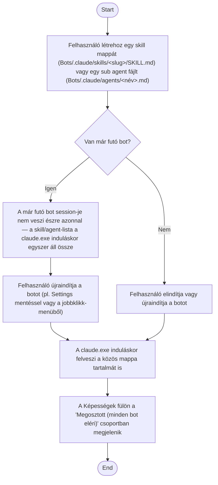

1. **Name:** Megosztott skill vagy sub agent felvétele minden bot számára

2. **Goal / short description:** A felhasználó egy skill-t vagy sub agent-definíciót a `Bots/.claude/`
   közös mappába helyez el (nem egy adott bot workspace-ébe), hogy azt **minden** bot — a
   meglévők és a jövőben létrehozottak is — elérje, anélkül hogy egyenként kellene másolnia vagy
   bot-onként külön beállítania.
   - **2.1 Precondition:** A felhasználó ismeri a skill (`<slug>/SKILL.md`, YAML frontmatterrel)
     és a sub agent (önálló `<név>.md`, YAML frontmatterrel) fájlformátumát.
   - **2.2 Exclusions:** Nincs felületi szerkesztő a létrehozáshoz vagy módosításhoz — ez
     fájlrendszeri művelet, ugyanúgy, ahogy egy bot saját skilljeinek/sub agentjeinek
     karbantartása sem a felületről történik (UC-009). A host nem validálja a frontmatter
     helyességét, és nem véd névütközés ellen egy bot saját, azonos nevű skillje/sub agentje
     esetén — ilyenkor mindkettő külön chipként jelenik meg.

3. **Actors:** Primary: felhasználó (fájlrendszer-szintű művelet). Secondary: `claude.exe`
   (minden egyes bot saját session-je, ami induláskor a munkakönyvtárból felfelé haladva magától
   felveszi — ez a CLI natív viselkedése, nem a host épít ki hozzá külön mechanizmust),
   `BotSessionManager.GetBotDetails` (a Képességek fülön "Megosztott" jelöléssel jeleníti meg).

4. **Flow:**

5. **Potential errors:** A skill/sub agent fájl formátuma hibás (hiányzó vagy rosszul zárt YAML
   frontmatter) → a leírás üresen marad, de a név — ha a mappa/fájlnév helyes — akkor is
   megjelenik; egy már futó bot a hozzáadás pillanatában nem érzékeli az új elemet, amíg nem
   indul újra, mert a skill/agent-lista a `claude.exe` induláskor, egyszer áll össze; egy bot
   saját `.claude/skills`/`.claude/agents` mappájában azonos nevű elem esetén mindkét forrás
   külön chipként jelenik meg, a host nem dönt el ütközést.

6. **Expected outcome:** Az új skill vagy sub agent — a bot újraindítása után — minden botnál
   elérhetővé válik, bot-onkénti másolás vagy külön beállítás nélkül, és a Képességek fülön
   "Megosztott (minden bot eléri)" jelöléssel, a bot saját elemeitől elkülönítve látható.
