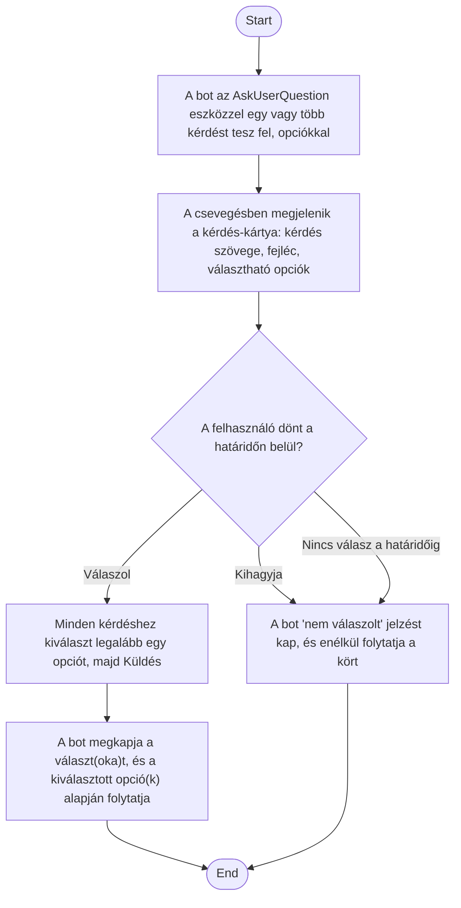

1. **Name:** Bot kérdésének megválaszolása (AskUserQuestion)

2. **Goal / short description:** A bot egy vagy több kérdést tesz fel a felhasználónak (az
   `AskUserQuestion` eszközzel), és választ adott opciók közül, mielőtt folytatná a feladatát.
   Ez eltér a tool-jóváhagyástól (UC-018): a felhasználó itt nem egy műveletet enged/tilt, hanem
   ténylegesen tartalmi választ ad, amire a bot a válaszában hivatkozik.
   - **2.1 Precondition:** A boton be van kapcsolva az interaktív jóváhagyás (ugyanaz a
     csatorna hordozza, mint UC-018-at), és az `AskUserQuestion` eszköz nincs kizárva.
   - **2.2 Exclusions:** Nem ad módot szabad szöveges válaszra — csak a bot által felkínált
     opciók közül lehet választani. Ha a bot `InteractiveApproval` nélkül fut, az eszköz
     egyáltalán nem érhető el a modell számára, és a kérdést egyszerű szöveges üzenetként teszi
     fel a csevegésben (ez a ma is működő, alap viselkedés, nem ehhez a use case-hez tartozik).

3. **Actors:** Primary: felhasználó. Secondary: `claude.exe` (a kérdés kezdeményezője és a válasz
   felhasználója), `BotSession` (a kérdés nyilvántartása és a válasz összeállítása — ugyanazon a
   mechanizmuson, mint a tool-jóváhagyás).

4. **Flow:**

5. **Potential errors:** A kérdés közben a bot leáll vagy újraindul → a kártya érvénytelenné
   válik, a felhasználó válasza már nem küldhető el; több kérdés esetén a Küldés gomb csak akkor
   aktív, ha mindegyikre érkezett legalább egy választás — hiányos kitöltéssel nem küldhető el a
   válasz.

6. **Expected outcome:** A kérdés megjelenik a csevegésben, nem vész el némán (ez volt a korábbi
   hiba), és akár választ ad a felhasználó, akár kihagyja, a bot kapott egyértelmű jelzést és
   **sikeresen** folytatja a kört — a kihagyás vagy a határidő lejárta nem minősül a feladat-futás
   sikertelenségének (ellentétben egy elutasított tool-jóváhagyással, UC-018), mert a
   `claude.exe` ezt az esetet a saját, kész "a felhasználó nem válaszolt" szövegével zárja le.
