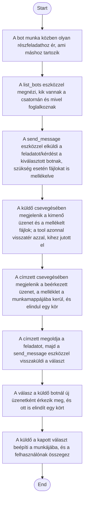

1. **Name:** Feladat delegálása vagy kérdés feltevése egy másik botnak

2. **Goal / short description:** Egy bot egy részfeladatot átad annak a botnak, amelyik ért hozzá
   (vagy egyszerűen kérdést tesz fel neki), és a választ a saját munkájába építi — anélkül, hogy a
   felhasználónak kézzel kellene átmásolnia az üzeneteket vagy a munkaanyagokat a két csevegés
   között. Az üzenethez fájlok is mellékelhetők (jelentés, terv, adatfájl), amiket a címzett a
   saját munkamappájában kap meg. A kommunikáció aszinkron: a küldés azonnal visszatér, a válasz
   később, önálló üzenetként érkezik.
   - **2.1 Precondition:** Mindkét bot fut, és mindkettőn be van kapcsolva a részvétel a közös
     bot-csatornán. Fájlmelléklethez a küldő előbb kiírja a fájlt a saját munkamappájába.
   - **2.2 Exclusions:** Nem ad szinkron kérés-választ (a küldő nem "vár" a válaszra, a saját körét
     lezárhatja közben), és nem ad külön, témánkénti csatornákat: egyetlen közös busz van, a
     címzés csak azt szűkíti, ki kapja meg. A fájlátadás egyirányú másolás: a címzett a saját
     példányán dolgozik, a küldő eredetijét nem módosítja. A felhasználó nem küld üzenetet erre a
     csatornára — ő a saját botjával a szokásos módon beszél (UC-002).

3. **Actors:** Primary: a kezdeményező bot (`claude.exe` session). Secondary: a címzett bot(ok), a
   hoszt üzenet-busza (`BotMessageBus`, a kézbesítés és a korlátok érvényesítése), valamint a
   felhasználó mint megfigyelő — a forgalom mindkét fél csevegésében látszik.

4. **Flow:**

5. **Potential errors:** A címzett nem fut, nincs a csatornán, vagy nincs ilyen nevű bot → a
   küldés nem történik meg, és a küldő bot szövegesen megtudja az okát, így más megoldást
   választhat (vagy szól a felhasználónak); a leállított bot a `recent_messages` eszközzel utólag
   felzárkózhat arra, amit kihagyott. Nem létező, a munkamappán kívülre mutató vagy túl nagy
   fájlmelléklet esetén az üzenet a többi melléklettel kimegy, a küldő pedig fájlonkénti
   indoklást kap — így tudja javítani a hivatkozást. Végtelen oda-vissza üzengetés ellen a válasz-lánc korlátozott
   mélységű, túl sok üzenetnél pedig időalapú korlát lép életbe — mindkét esetben a küldő
   elutasító, magyarázó választ kap a kiküldés helyett. A csatorna-részvétel kikapcsolása után a
   bot se nem küld, se nem kap üzenetet, a beszélgetés kontextusának elvesztése nélkül.

6. **Expected outcome:** A részfeladat — a hozzá tartozó munkaanyagokkal együtt — a megfelelő
   bothoz kerül, a válasz visszajut a
   kezdeményezőhöz, és a teljes bot-bot forgalom nyomon követhető mindkét fél csevegésében, a
   felhasználó üzeneteitől és a bot neki szóló válaszaitól vizuálisan megkülönböztetve. A puszta
   kézbesítés nem jelez olvasatlan üzenetet (UC-017) — az csak a felhasználónak szóló válasznál
   történik.
