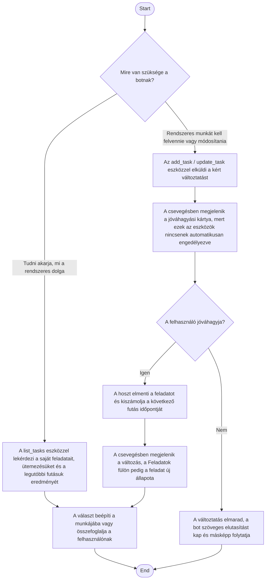

1. **Name:** Bot megnézi vagy módosítja a saját ütemezett feladatait

2. **Goal / short description:** A bot a saját munkája közben lekérdezi, milyen rendszeres
   feladatai vannak és azok hogyan futottak, illetve — a felhasználó jóváhagyásával — új
   feladatot vesz fel magának vagy módosít egy meglévőt. Így a "mostantól minden reggel nézd meg
   a…" típusú kérés ott teljesül, ahol elhangzik: a beszélgetésben, anélkül hogy a felhasználónak
   át kellene váltania a Feladatok fülre és kézzel kitöltenie az ütemezést.
   - **2.1 Precondition:** A bot fut. Íráshoz (új feladat, módosítás) a boton be van kapcsolva az
     interaktív jóváhagyás, különben a kérés elutasításra kerül.
   - **2.2 Exclusions:** A bot nem tud feladatot törölni — a legerősebb, amit tehet, a
     szüneteltetés. Nem látja és nem módosíthatja más botok feladatait. Nem indíthat feladatot
     azonnali futásra: az a felhasználó dolga (UC-014).

3. **Actors:** Primary: a bot (`claude.exe` session). Secondary: a felhasználó, aki a
   módosításokat jóváhagyja és a Feladatok fülön látja az eredményt; a hoszt, amely a feladatokat
   tárolja és ütemezi.

4. **Flow:**

5. **Potential errors:** Érvénytelen ütemezés (hiányzó időpont, üres naplista, nulla intervallum)
   → a feladat nem jön létre, a bot pedig mezőre szabott, javítható hibaüzenetet kap. Ismeretlen
   feladatazonosító módosításkor → a bot visszakapja, hogy a `list_tasks` eszközzel nézze meg a
   sajátjait. Kikapcsolt interaktív jóváhagyás mellett az írás elutasításra kerül — az olvasás
   ilyenkor is működik, így a bot felügyelet nélküli, éjszakai körben is tudja, mi a dolga.

6. **Expected outcome:** A bot ismeri a saját rendszeres feladatait, és a felhasználó
   jóváhagyásával alakítani is tudja őket. Minden változás ugyanott jelenik meg, ahol a kézzel
   felvett feladatok (Feladatok fül), és a csevegésben is nyoma marad — így a felhasználó akkor
   sem veszíti el a kontrollt, ha egy eszközt tartósan engedélyezett.
